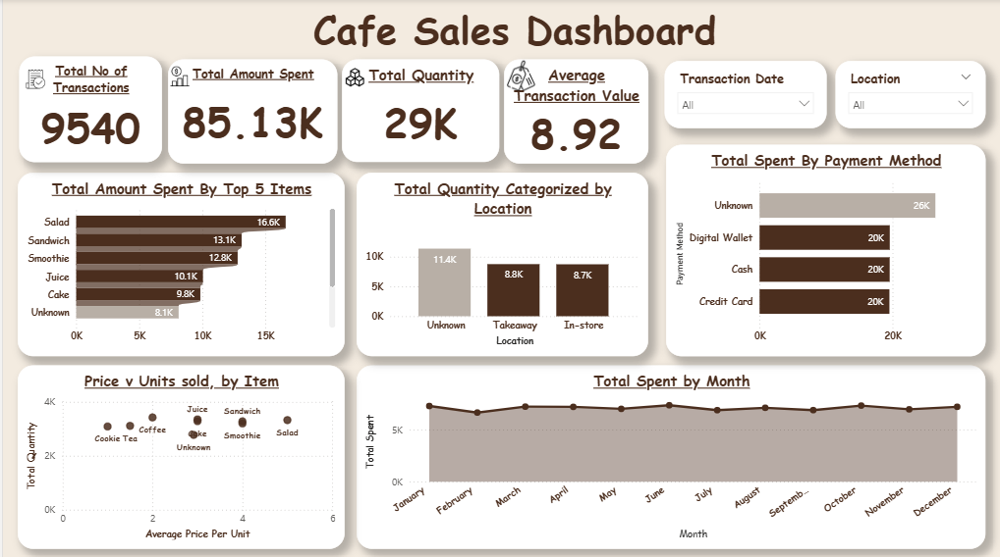

# Data Cleaning: Cafe Sales (Python / pandas)

A deliberately messy 10,000-row cafe sales dataset, cleaned step by step in a Jupyter notebook. Every decision is documented in the notebook's markdown cells.

Source: https://www.kaggle.com/datasets/ahmedmohamed2003/cafe-sales-dirty-data-for-cleaning-training/data

## Result
| Metric | Before | After |
|---|---|---|
| Rows | 10,000 | 9,540 |
| Missing values (real nulls + "UNKNOWN"/"ERROR" text) | 10,082 | 0 |
| Duplicate rows | 0 | 0 |

The "Unknown" labels left in Item, Payment Method and Location are deliberate categories, not missing data.

## What I did
- Types: converted numeric and date columns from text. Quantity is an integer, prices are floats, Transaction Date is datetime.
- Hidden missing values: "UNKNOWN" and "ERROR" are text, so isna() cannot see them. I converted them to real nulls so they could be handled consistently.
- Missing values, by column:
  - Quantity, Price Per Unit, Total Spent: calculated from the other two where possible (Total = Quantity × Price). Remaining gaps used the median (price: median per item first).
  - Item, Payment Method, Location: filled with "Unknown". Too much was missing for mode imputation, which would invent a majority category.
  - Transaction Date: 460 rows (4.6%) deleted. Rows are not in date order, so forward fill is invalid, and a date cannot be inferred from other columns. Missing dates were spread evenly across Location, so deletion does not bias the data.
- Duplicates: none found.
- Standardisation: checked all text columns for case and spacing issues. None found.
- Outliers (IQR): none in Quantity or Price Per Unit. 260 Total Spent values were flagged above 24. [your decision and reason, from the reconcile check]

## Known limitation
Total Spent does not equal Quantity × Price Per Unit in some rows (largest gap found: 16.0). These rows were flagged, not corrected. The number of affected rows was not counted.

## Dashboard

Built in Power BI from the cleaned data (9,540 transactions, 85.13K total spent, about 29K units).

### Key insights
- Three items bring in about half the revenue. Salad, Sandwich and Smoothie total roughly 42.5K, and they are the three highest-priced items.
- Revenue follows price, not popularity. Units sold are similar across items (about 2.8K to 3.4K each), so cheaper items rank lower in revenue.
- No seasonality. Monthly spend stays within about 10% all year.
- Payment methods are evenly split. Cash, Credit Card and Digital Wallet are each about 20K.

### Caveats
- "Unknown" is about 39% of units by Location and about 30% of spend by Payment Method (missing in the source data). It is kept and shown in grey, so these two breakdowns are unreliable for decisions.
- Revenue uses the recorded Total Spent, which does not always equal Quantity × Price (see the Known limitation above).
- The data is unusually even, which suggests it is synthetic. Treat the insights as analysis practice, not business advice.

### Suggested actions
- Make Location and Payment Method required fields at data capture.
- Before treating February as weak, compare revenue per day.
- Test any price change with a limited trial, since each item has only one price in this data.

## Files
- cafe-sales-data-cleaning.ipynb: the full analysis and documented decisions
- cleaned_data.csv: the cleaned output

Tools: Python, pandas, Jupyter, Power BI
